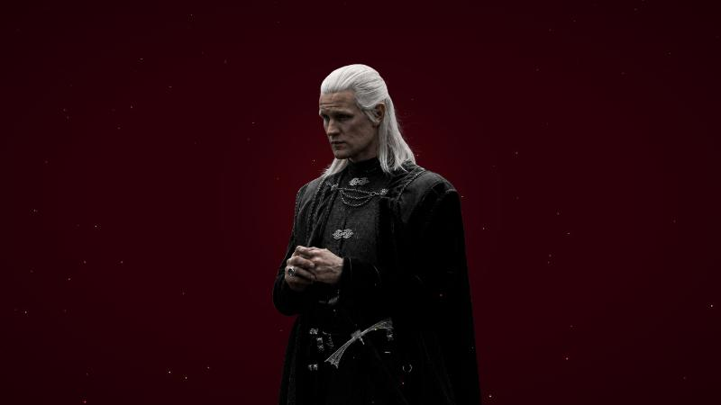

<div align="center">

# Daemon

<a href="https://eduardoholkem.github.io/wallpapers/live/daemon/"></a>
<a href="https://github.com/EduardoHolkem/wallpapers/releases/tag/daemon-v1.1.1"></a>


<br/><br/>

<a href="https://eduardoholkem.github.io/wallpapers/live/daemon/"></a>
<br/>
<sub>clique na imagem para ver o wallpaper rodando no navegador</sub>

</div>

## Sobre

**Daemon** é um wallpaper animado com Daemon Targaryen sobre um fundo vermelho escuro. Brasas douradas e vermelhas sobem na frente dele e vão encolhendo, como se esfriassem no caminho, enquanto um brilho pulsa nas costas como uma fogueira. A imagem respira devagar, o suficiente para parecer viva sem distrair.

Ele nasceu da mesma base do Jon Snow e foi reescrito para ficar mais leve e no mesmo padrão do [Lilacs](../lilacs).

## Recursos

| | |
|---|---|
| **Brasas subindo** | três tipos, douradas com brilho forte, vermelhas e cinzas escuras, que encolhem enquanto sobem |
| **Brilho pulsante** | uma luz vermelha atrás da personagem que cresce e diminui devagar |
| **Respiração** | a imagem aumenta e diminui bem de leve, num ciclo de seis segundos |
| **Relógio** | hora e data em português, no canto superior esquerdo, que acompanham o tamanho da tela |
| **Leve** | brasas desenhadas a partir de imagens prontas, todas as animações no mesmo ritmo do FPS escolhido e um modo leve que liga sozinho em PC sem placa de vídeo |
| **Qualquer tela** | brasas e relógio acompanham o tamanho da tela, então fica igual num monitor grande, num notebook ou num Steam Deck |

## Instalação

Baixe o arquivo da sua plataforma na [release do Daemon](https://github.com/EduardoHolkem/wallpapers/releases/tag/daemon-v1.1.1).

<details open>
<summary><b>Wallpaper Engine</b></summary>
<br/>

1. Baixe `Daemon-WallpaperEngine.zip` e extraia a pasta `Daemon` dentro de `wallpaper_engine/projects/myprojects`.
2. Abra o Wallpaper Engine. O Daemon aparece na sua lista de wallpapers. Se não aparecer, use **Abrir wallpaper** e escolha `Daemon/index.html`.

</details>

<details open>
<summary><b>Lively Wallpaper</b></summary>
<br/>

1. Baixe `Daemon-Lively.zip` (não precisa extrair).
2. Arraste o zip para dentro da janela do Lively.
3. Clique com o botão direito no wallpaper e use **Personalizar** para mudar as opções.

</details>

<details open>
<summary><b>Sem Wallpaper Engine nem Lively</b></summary>
<br/>

Baixe a imagem estática, sem o relógio, e use como papel de parede comum no PC ou no celular. Ela leva a minha assinatura bem pequena no canto inferior direito.

- [Imagem para PC (2560x1440)](https://eduardoholkem.github.io/wallpapers/imagens/Daemon-PC.jpg)
- [Imagem para celular (1080x2340)](https://eduardoholkem.github.io/wallpapers/imagens/Daemon-Celular.jpg)

</details>

## Opções

| Opção | Padrão | O que faz |
|---|---|---|
| Quantidade de brasas | 100% | de 0 a 200% |
| Brilho atrás da personagem | ligado | a luz vermelha pulsando |
| Mostrar relógio | ligado | hora e data no canto superior esquerdo |
| Mostrar assinatura do criador | ligado | meu nome pequeno no canto inferior direito |
| Desempenho | automático | no automático, o modo leve liga sozinho quando o PC não tem placa de vídeo ou não sustenta o FPS. Ele deixa o brilho e a personagem parados e desenha as brasas sem esticar a imagem, o que pesa bem menos |
| FPS | 30 | limite de quadros por segundo |

## Estrutura

```
daemon
├── src/                código do wallpaper (index.html e imagem)
├── wallpaper-engine/   project.json com as opções do Wallpaper Engine
├── lively/             LivelyInfo.json e LivelyProperties.json
├── imagem/             imagem estática para PC e celular
└── assets/             prévia
```

## Créditos

Feito por **[Eduardo Holkem](https://github.com/EduardoHolkem)** com HTML, CSS e JavaScript puro.

Este é um projeto de fã, sem ligação oficial com House of the Dragon ou com a HBO. Personagem e imagem pertencem aos seus donos. O código está sob a licença MIT.
