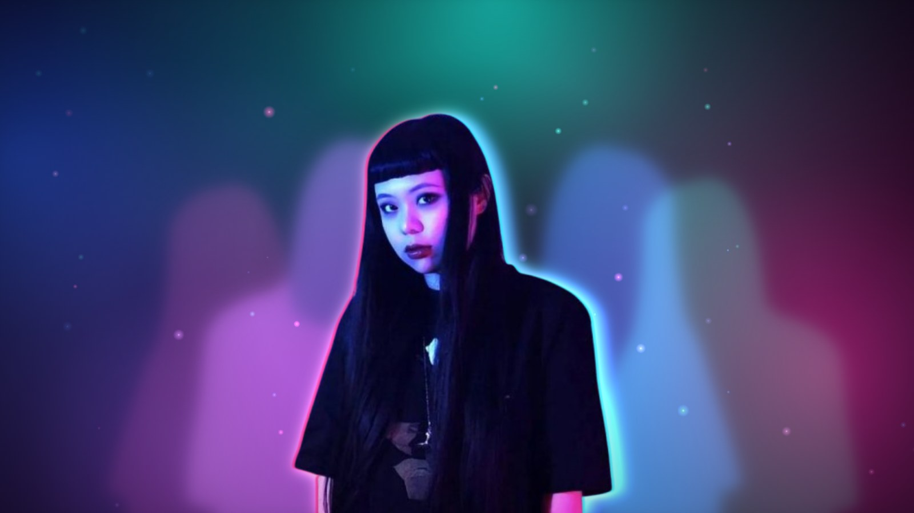

<div align="center">



<br/>

<a href="https://eduardoholkem.github.io/wallpapers/live/lilacs/"></a>
<a href="https://github.com/EduardoHolkem/wallpapers/releases/tag/lilacs-v2.1.0"></a>


</div>

<br/>

<div align="center">
  <a href="https://eduardoholkem.github.io/wallpapers/live/lilacs/"></a>
  <br/>
  <sub>clique na imagem para abrir a demo animada no navegador</sub>
</div>

<br/>

## Sobre

**Lilacs** é meu quarto wallpaper animado para desktop, nascido de uma música que eu escuto sem parar enquanto programo, *Lilacs*, do **Pastel Ghost**. A ideia foi transformar a sensação dela em imagem, com aquela mistura de dream pop, neon e fita VHS gasta.

A cena é feita em camadas. Atrás, quatro cores giram devagar pela tela. No meio, fantasmas luminosos espelhados da personagem flutuam em volta dela, e um halo de luz RGB pulsa como batida de coração. Na frente, granulação, scanlines e um glitch de vez em quando deixam tudo com cara de memória borrada.

E como a música é o ponto de partida, o wallpaper também mostra **o que você está ouvindo agora**, com capa, nome, banda e **a letra sincronizada linha por linha**.

Existem duas versões com o mesmo código, uma para o **Wallpaper Engine** (Steam) e outra para o **Lively Wallpaper** (Microsoft Store, gratuito).

## Recursos

| | |
|---|---|
| **Fundo de quatro cores** | rosa, lilás, azul e ciano girando em volta do centro, todas personalizáveis |
| **Fantasmas espelhados** | quatro silhuetas desfocadas da personagem, uma para cada cor, em profundidades diferentes |
| **Halo de luz RGB** | cópias vermelha, verde e azul atrás dela que abrem e fecham num pulso contínuo |
| **Aberração cromática** | franjas rosa e ciano nas bordas da personagem |
| **Glitch procedural** | a imagem se fatia em faixas por uma fração de segundo, em intervalos aleatórios |
| **Tocando agora** | capa, música, banda e progresso de qualquer player do controle de mídia do Windows. A caixa some quando a música pausa ou para |
| **Letra sincronizada** | a letra rola sozinha e destaca a linha atual no tempo da música. Sem letra, ou quando ela acaba, a caixa encolhe e mostra só capa, música e banda |
| **Partículas e feixes de luz** | brilhos subindo devagar e dois holofotes balançando |
| **Estética VHS** | granulação animada, scanlines e vinheta |
| **Parallax** | as camadas reagem ao mouse em profundidades diferentes |
| **Relógio discreto** | opcional, só hora e dia, sem brilho |
| **Leve** | efeitos borrados desenhados em resolução menor e personagem desenhada uma vez só. A qualidade automática percebe quando o PC não tem placa de vídeo ou não sustenta o FPS e vai baixando sozinha até a mínima |
| **Qualquer tela** | partículas, caixa da música e relógio acompanham o tamanho da tela, então fica igual num monitor grande, num notebook ou num Steam Deck |
| **Tudo ajustável** | cada efeito pode ser desligado nas configurações do Wallpaper Engine e do Lively |

## Instalação

Baixe o arquivo da sua plataforma na [release do Lilacs](https://github.com/EduardoHolkem/wallpapers/releases/tag/lilacs-v2.1.0). Todos os wallpapers ficam no [hub](https://eduardoholkem.github.io/wallpapers/).

<details open>
<summary><b>Wallpaper Engine</b></summary>
<br/>

1. Baixe `Lilacs-WallpaperEngine.zip` e extraia a pasta `Lilacs` dentro de `wallpaper_engine/projects/myprojects`.
2. Abra o Wallpaper Engine. O Lilacs aparece na sua lista de wallpapers. Se não aparecer, use **Abrir wallpaper** e escolha `Lilacs/index.html`.
3. Para a música aparecer, abra **Configurações › Geral** e ligue a **integração de mídia**.

</details>

<details open>
<summary><b>Lively Wallpaper</b></summary>
<br/>

1. Baixe `Lilacs-Lively.zip` (não precisa extrair).
2. Arraste o zip para dentro da janela do Lively. Ele entra na biblioteca com prévia e descrição.
3. Clique com o botão direito no wallpaper e use **Personalizar** para mudar cores e opções.

</details>

<details open>
<summary><b>Sem Wallpaper Engine nem Lively</b></summary>
<br/>

Baixe a imagem estática, sem relógio, sem a caixa da música e sem o glitch, e use como papel de parede comum no PC ou no celular. Ela leva a minha assinatura bem pequena no canto inferior direito.

- [Imagem para PC (2560x1440)](https://eduardoholkem.github.io/wallpapers/imagens/Lilacs-PC.jpg)
- [Imagem para celular (1080x2340)](https://eduardoholkem.github.io/wallpapers/imagens/Lilacs-Celular.jpg)

</details>

## Música e letra

O wallpaper lê a música pelo controle de mídia do Windows, então funciona com o **Spotify** de desktop, o **YouTube Music** no Chrome ou no Edge e qualquer outro player que apareça ali.

A letra não vem junto com o wallpaper. Quando a faixa muda, ele busca a letra sincronizada no [LRCLIB](https://lrclib.net), uma base aberta e gratuita, e guarda em cache. Títulos bagunçados do YouTube, como `Banda - Música (Official Video)`, são limpos antes da busca.

> [!NOTE]
> O Wallpaper Engine informa a posição exata da música quando o player permite (o Spotify permite). O Lively informa só a troca de faixa, então lá a letra começa a contar quando a música muda. Se ela ficar adiantada ou atrasada, use a opção **Ajuste da letra**.

## Opções

| Opção | Padrão | O que faz |
|---|---|---|
| Cor 1 a Cor 4 | rosa, lilás, azul, ciano | cores do fundo e dos fantasmas |
| Qualidade | automática | se ajusta ao PC sozinha. Também dá para fixar em alta, equilibrada, leve ou mínima, que foi feita para PC sem placa de vídeo |
| FPS | 30 | limite de quadros por segundo |
| Glitch na personagem | ligado | fatiamento rápido da imagem |
| Contorno rosa e ciano | ligado | aberração cromática nas bordas da personagem |
| Sombras coloridas | ligado | os quatro fantasmas espelhados |
| Brilho atrás da personagem | ligado | halo de luz RGB pulsando |
| Holofotes | ligado | os dois feixes de luz vindos do topo |
| Partículas de luz | ligado | brilhos subindo devagar |
| Pontilhado e linhas | ligado | granulação e scanlines do efeito VHS |
| Intensidade do pontilhado | 25 | força da granulação |
| Cantos escuros | ligado | vinheta nas bordas da tela |
| Parallax com o mouse | ligado | camadas reagem ao cursor |
| Mostrar relógio | desligado | hora e dia no canto superior esquerdo |
| Mostrar música tocando | ligado | caixa com capa, música e banda enquanto a música toca |
| Mostrar letra sincronizada | ligado | letra dentro da caixa |
| Posição da caixa | inferior esquerdo | também pode ir para a direita ou para cima |
| Ajuste da letra | 0 s | adianta ou atrasa a letra em até 5 segundos |

## Estrutura

```
lilacs
├── src/                código do wallpaper (index.html e imagem)
├── wallpaper-engine/   project.json com as opções do Wallpaper Engine
├── lively/             LivelyInfo.json e LivelyProperties.json
├── imagem/             imagem estática para PC e celular
├── assets/             banner e prévia
└── demo.js             música de demonstração usada na prévia do hub
```

Para mexer no código, edite `src/index.html` e, na raiz do repositório, rode

```bash
node build.js
```

Isso gera as versões e os zips em `dist/` e o site do hub em `site/`.

## Créditos

Feito por **[Eduardo Holkem](https://github.com/EduardoHolkem)** com HTML, CSS e JavaScript puro.

Este é um projeto de fã, sem ligação oficial com o Pastel Ghost. Música, nome e imagens pertencem aos seus donos. As letras exibidas são buscadas no LRCLIB no momento em que a música toca e não fazem parte deste repositório. O código está sob a licença MIT.

<div align="center">
<br/>
<sub>se esse wallpaper combinou com o seu setup, deixa uma estrela.</sub>
</div>
